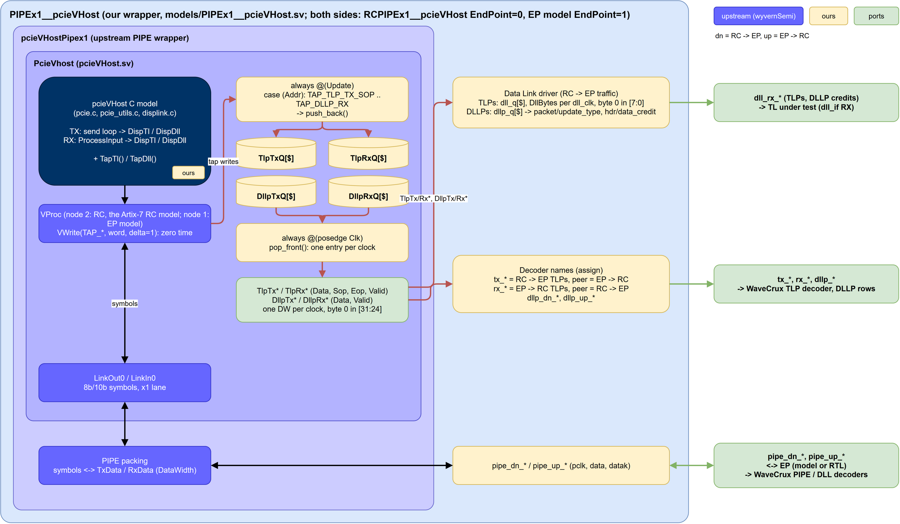

# openPCIE_BFM: integration notes

How the model attaches to a design, what it exposes, and how to build it for each simulator.

## Three ways to attach pcieVHost

One model (the same core, C model and patches) with an adapter for what it talks to, so a fix or a calibration holds for all three:

| Adapter | The model plays | It talks to | Files | PIPE |
|---|---|---|---|---|
| **Line** | a whole node on the wire | another model | `pcieVHostPipex1.sv`, `pcieVHostPipexN.sv`; `Serialiser.sv` with `IFACE=serial` | not PIPE: it models the line. Idle is `NOSIG` ([special values](pcievhost/README.md#special-values-on-the-line)). The fastest with `IFACE=pipe`: a symbol per clock, no 8b/10b, no scrambling; the regression runs on it. `IFACE=serial` steps every bit, 8b/10b and scrambling on, so it is slower |
| **PIPE-PHY** | the PHY and the far node | an RTL MAC directly, with no SerDes | openPCIE_BFM's `pipe_phy_core.sv`, wrapped by `models/phy_top.EP-PIPE-BFM.sv` (the hard macro's MAC); in openCologne-PCIE by `phy_vproc_rc.sv` (its EP's MAC) | the PHY side of PIPE with its handshakes: PhyStatus on power-state and rate changes (and in PIPE reset, but not for the hard macro: `RST_LAT = 0`), receiver detection; TxElecIdle in, RxElecIdle and RxValid out. Shortcuts: a receiver is always present for the hard macro (`rcvr_present` tied to 1; `PHY=core` ties it to the endpoint's reset, so the first detection fails), PCLK switches at once on a rate change |
| **PIPE-MAC** | the MAC | a PIPE PHY | openPCIE_BFM's `pipe_mac_adapter.sv`; on `pipe_phy_core.sv` (`RC=model PHY=core`), and in the hard macro's socket (`PHY=hm`, `models/pcie_core.RC-model.sv`): x1 and x4, Gen1 and Gen2 pass as without it | the MAC side of PIPE, with its handshakes: PIPE reset, receiver detection in P1 (again after a quiet time if none), P0, rate change; idle per lane. Its rules are assertions that end the run |

The SerDes BFM stays below all three, at the level of the GateMate silicon.

## Transaction taps

Each pcieVHost reports every TLP and DLLP it sends and receives on ports of its own: transaction taps we added to the model (openPCIE_BFM's `1.upstream/patches/pcievhost-taps.patch`).

- **C side** (`src/displink.c`): `TapTl()` / `TapDll()`, called from `DispTl()` / `DispDll()`, write each TLP DW and each DLLP word to new addresses in `src/pcie_vhost_map.h`, with VProc delta writes, so no simulation time passes.
- **HDL side** (`pcieVHost.sv`): SystemVerilog queues play those words out one per clock on `TlpTx*` / `TlpRx*` (`Data`, `Sop`, `Eop`, `Valid`) and `DllpTx*` / `DllpRx*` (`Data`, `Valid`). `pcieVHostPipex1.sv` passes them through.
- **TLP format:** byte 0 in bits 31:24, no framing, sequence number or LCRC. Nullified TLPs (EDB) are left out. DLLPs carry their 4 bytes, no CRC.
- openPCIE_BFM's wrapper `PIPEx1__pcieVHost` offers each packet at three layers, from one run, all always present.
- Both sides use it: the host `RCPIPEx1__pcieVHost` (`EndPoint=0`) and the EP model `EPPIPEx1__pcieVHost_DUT` (`EndPoint=1`).
- Each side has its decoder page, `tb.u_rc` and `tb.dut.bfm_pcie`, with the same names by link direction (dn = RC -> EP, up = EP -> RC). A packet shows on both, a link latency apart.

<div align="center">

</div>

| Layer | Ports of `tb.u_rc`, `tb.dut.bfm_pcie` | For |
|---|---|---|
| PIPE | `pipe_dn_*`, `pipe_up_*` (`pclk`, `data`, `datak`) | the link; PIPE and DLL decoders |
| Data Link | `dll_rx_*`, on `dll_clk`: TLPs (`data`, `tlp_valid`, `tlp_first`, `tlp_last`) and DLLPs (`hdr_credit`, `data_credit`, `update_type`, `packet_type`, `dllp_valid`) | RC -> EP traffic as an EP's DLL hands it to its TL (`dll_if` RX side): drives a TL under test |
| Data Link | `dllp_dn_*`, `dllp_up_*` | every DLLP, one word each |
| Transaction | `tx_*` (RC -> EP), `rx_*` (EP -> RC) | the TLP decoder |

The `dll_rx_*` fields follow the DLL ([DLL draft v2](https://github.com/chili-chips/openCologne-PCIE/blob/main/2.rtl/0.doc/260711-DLL_draft_v2.pdf), slides 7 and 9): TLP byte 0 in `data[7:0]`, the first byte on the wire; DLLP Type = {`packet_type`, `update_type`, 0, VC}, so `packet_type` 01 InitFC1, 11 InitFC2, 10 UpdateFC, and `update_type` 00 P, 01 NP, 10 Cpl. Like the DLL, every DLLP raises `dllp_valid`.

What it gives us:

- **RTL driven from the model.** `dll_rx_*` has the shape of `dll_if`'s RX side, so a TL can be tested without the MAC and DLL below it, on its own clock.
- **A reference for the DUT.** What the host sent and received, packet by packet, to compare against the DUT's own TL and DLL interfaces with `EP=rtl`.
- **Self-checking tests.** A checker reads the taps, not the console log.
- **Decoder fixtures from an open simulator.** Verilator and Icarus give the same TLPs at the same times (50 each way in the enumeration run), with expected values from the model, not from a decoder.
- **Any link partner.** The host's taps work with the EP model and the EP RTL alike; with the EP model, both ends of the link are tapped.

## VProc and mem.h API

A VProc program is ordinary C or C++, except its entry point is `VUserMain<n>()`, with C linkage, instead of `main()`: the simulator already has a `main()`, and each node has its own program. VProc's scheduler talks to the simulator over DPI-C (Verilator) or VPI (Icarus), invisibly to the program. VProc offers a low-level C API and a C++ one, the `VProc` class in `VProcClass.h` (headers in `$VIP_DIR/include`, see [Running the co-simulation](https://github.com/chili-chips/openCologne-PCIE/blob/main/5.sim/README.md#running-the-co-simulation)):

```c++
VProc (const uint32_t node);

int  write (const unsigned addr, const unsigned  data, const int delta=0);
int  read  (const unsigned addr,       unsigned *data, const int delta=0);
int  tick  (const unsigned ticks);
```

Addresses are byte addresses; `delta` stays at its default. `tick()` advances simulation time by a number of cycles of the node's clock, without a bus transaction. Finer accesses: `writeByte`, `writeHword`, `writeWord` and their `read` twins; the rest is in the [VProc manual](https://github.com/wyvernSemi/vproc/blob/master/doc/VProc.pdf).

A program can also reach the sparse memory model directly, through `mem.h` (C functions: `extern "C"` from C++):

```c++
void     WriteRamByte  (const uint64_t addr, const uint32_t data, const uint32_t node);
void     WriteRamHWord (const uint64_t addr, const uint32_t data, const int little_endian, const uint32_t node);
void     WriteRamWord  (const uint64_t addr, const uint32_t data, const int little_endian, const uint32_t node);
uint32_t ReadRamByte   (const uint64_t addr, const uint32_t node);
uint32_t ReadRamHWord  (const uint64_t addr, const int little_endian, const uint32_t node);
uint32_t ReadRamWord   (const uint64_t addr, const int little_endian, const uint32_t node);
```

No default arguments (C). `node` selects a memory space, not a VProc node; we use one, 0. Every `mem_model` instance in the HDL sees the same memory as this API, so programs and logic exchange data through it.

## VProc and mem_model

_VProc_ (virtual processor) and _mem_model_ (sparse memory, part of _pcievhost_) share one memory: VProc programs reach it through the API, logic through the `mem_model` HDL component, and code on the pcieVHost's own VProc through the API too.

### _VProc_

_VProc_ runs a natively compiled user program on an HDL processor component. C/C++ APIs issue reads and writes on its HDL bus and advance simulation time.

<div align="center"></div>

* **Bus:** generic memory mapped. openPCIE's `soc_cpu.VPROC.native` wrapper turns it into picorv32's native interface (`mem_valid`/`mem_ready`) with a little logic.
* **Nodes:** instantiate as many as needed, each with a unique node number. Node *n* runs `VUserMain<n>` (e.g. `VUserMain0`), with C linkage for DPI.
* **Link to the simulator:** SystemVerilog DPI-C. The user program runs as a coroutine on the simulator's thread, in lock-step with the simulation.
* **Build:** user programs and the _VProc_ library link into one shared object, `VProc.so`, loaded by the simulator at run time.

C and C++ APIs, abbreviated:

<div align="center"></div>

User code runs in zero simulation time. Time advances on each transaction, or with `tick` without one. With these calls alone you can write test programs that drive the core's CSR registers from `soc_cpu.VPROC`, such as:

<div align="center"></div>

### _mem_model_

[mem_model](https://github.com/wyvernSemi/mem_model) is a sparse memory written in C as part of [_pcievhost_](https://github.com/wyvernSemi/pcievhost), plus a `mem_model` HDL component with Avalon style ports (memory mapped, burst, write). _VProc_ code calls the C API directly:

<div align="center"></div>

* Writes take `address`, `data` and, for wider words, a little-endian flag `le`. Reads take `address` (and `le` where needed) and return the value.
* Every function takes `node`: an address space, not the _VProc_ node. Almost always 0.
* The HDL component may be instantiated any number of times; all instances see the same memory, shared with every _VProc_.

<div align="center"></div>

## Build defines

| Define | Set by | Effect |
|---|---|---|
| `EXCLUDE_LTSSM` | the user's make file | leaves the LTSSM out of the pcieVHost model; the user code links `3.sw/ltssm/ltssm.c` instead |
| `VPROC_SV` | `4.build/build-vip.sh` (DPI-C build) | VProc over SystemVerilog DPI-C: Verilator, XSIM, JanusHDL |
| `ICARUS`, `VPROC_PLI_VPI`, `EXTERN_VPI_TABLE`, `_REENTRANT` | `4.build/build-vip.sh` (VPI build) | VProc and pcieVHost over VPI for Icarus; the VPI table comes from pcieVHost's `veriuser.c`; thread-safe C library calls |
| `VPROC_BYTE_ENABLE` | the user's make file | byte enables on the VProc bus, in VProc and pcieVHost (`BE` port) |
| `VPROC_THREADS` | the user's make file | VProc keeps one thread per node instead of coroutines (sanitizer runs) |

`2.rtl/mem_model.sv` exists only to wrap upstream's `mem_model.v` (kept as `f_mem_model.sv`) in Verilator `lint_off` pragmas, so third-party code stays out of a user's lint.

## From XSIM to Verilator, via Icarus

openPCIE ran this model on XSIM only; openCologne-PCIE moved it to Verilator and Icarus. What that took:

1. **Libraries built from source, per simulator.** XSIM loaded prebuilt `libcosimlnx.a` / `libpcielnx.a`. Verilator reaches the C models through DPI-C, Icarus through VPI, each needing its own build of the same sources, so openPCIE_BFM's `4.build/build-vip.sh` builds both: `libcosimlnx.a` / `libpcielnx.a` for DPI-C, `libcosimica.a` / `libpcieica.a` for VPI. The VPI library also carries pcieVHost's `veriuser.c`, the table that registers the models' system tasks with Icarus.
2. **Every referenced module must exist.** The pcieVHost wrappers instantiate `clkmux` and `Serialiser` (from pcieVHost's `verilog/lib`), never compiled by the XSIM file list. Verilator wants every referenced module, so the VIP build now collects them.
3. **Electrical idle: `NOSIG`.** An electrically idle PCIE line carries no signal. Upstream models it as `Z` on a 4-state simulator, and under Verilator (2-state) as zeros plus a side-band, `ElecIdleOut` and `ElecIdleIn`. openPCIE's patch drops both: each idle symbol on the PIPE is `NOSIG`, the K flag and `0xFF` (no 8b/10b code), on Verilator and Icarus alike. Verilator can't be trusted with `Z` here: its `=== 'z` reads a driven 0 as `Z` ([#17](https://github.com/chili-chips/openCologne-PCIE/issues/17)).
4. **One LTSSM on both sides.** On openPCIE the model plays the EP, an upstream port, against a real `PCIE_2_1` downstream port; the patch makes it spec-correct: an upstream port keeps sending Link/Lane = PAD in its TS1 until the downstream port assigns the numbers. Upstream's model takes a shortcut that only works against a copy of itself, so the patched EP would deadlock in Configuration.Start against pcieVHost's own RC, on both simulators. With upstream's RC as our host, we used upstream's `ltssm.c`. The host is now openPCIE's Artix-7 RC model, which assigns Link and Lane numbers as the hard macro does, so both sides use openPCIE's `ltssm.c`, patch included.
5. **Macros before models.** The pcieVHost models use macros (`WsTimeScale`, `RegDel`, the comma symbols, the register map) from its headers. Under Verilator the first file in the list happened to pull them in for all others; not under Icarus. [`tb.f`](https://github.com/chili-chips/openCologne-PCIE/blob/main/5.sim/tb.f) now names `allheaders.svh` first, for both.
6. **Portable delays.** Icarus rejected the test bench's `#(N * 1ps)` delays. The file's timescale is 1 ps, so plain numbers mean the same everywhere; the run limit is a 64-bit constant, as 10 ms in picoseconds overflows 32 bits.

--------------------
#### End of Document
