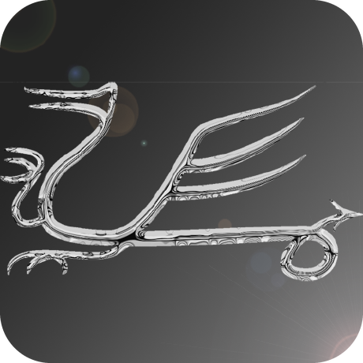
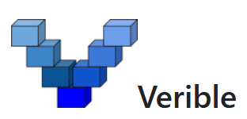

# openPCIE_BFM

[](https://github.com/chili-chips/openPCIE_BFM/stargazers)
[](https://gitlab.com/chili-chips/openPCIE_BFM)
[](LICENSES)
[](REUSE.toml)
[](https://github.com/wyvernSemi/pcievhost)
[](https://github.com/wyvernSemi/vproc)
[](#self-test)
[](#self-test)
[](#self-test)
[](https://que.no/janushdl/)
[](https://wavecrux.app)
[](https://github.com/chipsalliance/verible)

A PCIE simulation model (bus functional model) for PIPE-based PCIE designs, built on Simon Southwell's [pcieVHost](https://github.com/wyvernSemi/pcievhost) and [VProc](https://github.com/wyvernSemi/vproc). One model plays the Root Complex or the Endpoint, x1 or x4, Gen1 or Gen2, at the PIPE or on the serial line.

It is shared by [openPCIE](https://github.com/chili-chips/openPCIE) (Artix-7 Root Complex) and [openCologne-PCIE](https://github.com/chili-chips/openCologne-PCIE) (GateMate Endpoint), as a git submodule of both.

What it adds to upstream pcieVHost:

- **PIPE adapters.** Our wrappers put the model on a PIPE link (x1 or x4), offer the link at the PIPE, Data Link and Transaction layers for waveform decoders, and act as the MAC or the PHY side of a PIPE with its handshakes.
- **The Artix-7 RC model.** pcieVHost set up as the AMD `PCIE_2_1` root port, calibrated against the hard macro. It trains the link, runs the RC firmware's requests and checks the Endpoint against 59 rules of the PCIE spec.
- **Model fixes and features.** Gen2 speed change through Recovery, lane reversal and polarity, one electrical-idle rule with no X or Z, transaction taps, fault injection, coroutines in VProc (about 22 times faster). Details: [doc/pcievhost](doc/pcievhost/README.md) and the [openPCIE simulation README](https://github.com/chili-chips/openPCIE/blob/main/5.sim/README.md#pcievhost-what-we-added-or-removed).

## Layout

| Path | What | License |
|---|---|---|
| `hdl/` | our SystemVerilog: `PIPExN__pcieVHost.sv` (x1/x4, Gen1/Gen2), `pcieVHostPipexN.sv` (upstream's PIPE wrapper for N lanes), `PIPEx1__pcieVHost.sv` and `RCPIPEx1__pcieVHost.sv` (x1 Gen1), `pipe_mac_adapter.sv` (MAC side of PIPE), `pipe_phy_core.sv` (PHY side of PIPE), `pipe_sym_pkg.sv`, `pipe_x4_view.sv`, `mem_model.sv` | BSD-3-Clause; `pcieVHostPipexN.sv`, `mem_model.sv` GPL-3.0-or-later |
| `a7rc/` | the Artix-7 RC model: `VUserMain2.cpp` (VProc node 2), its checker `a7rc_check.cpp`, `ep_dma.h` | BSD-3-Clause |
| `ltssm/` | the LTSSM helper both nodes link in: `ltssm.c` (ours), `ltssm.c.orig` (upstream), `ltssm-openpcie.patch` | GPL-3.0-or-later |
| `patches/` | our changes to upstream: `pcievhost-taps.patch` (applied at import), `pcievhost-speed.patch`, `vproc-coroutine.patch` (applied at build) | GPL-3.0-or-later |
| `vip/` | upstream copies: VProc, pcieVHost, mem_model ([versions](vip/README.md)) | GPL-3.0-or-later |
| `tools/` | `vip-import.sh` (upstream to `vip/`), `build-vip.sh` (libraries and HDL), `regress.sh` (seeds), `wavecrux.py` (a run in WaveCrux at the first violation) | BSD-3-Clause |
| `selftest/` | the RC model against the Endpoint model, back to back | BSD-3-Clause |
| `doc/pcievhost/` | how to configure and drive the model | GPL-3.0-or-later |

## Self-test

Two pcieVHost nodes on one PIPE link: the Artix-7 RC model (node 2) against an Endpoint model (node 1, `selftest/usercode/VUserMain1.cpp`). It passes when the RC model prints `RC MODEL RESULT: PASS`: link up, every request completed, 0 rule violations.

```sh
cd selftest
make run                  # Verilator (default)
make SIM=icarus WRAP=x1 run   # Icarus runs the x1 wrappers only
make SIM=xsim run         # Vivado simulator
make SIM=janushdl run     # JanusHDL (jhdl)
make all-sims             # each simulator, one line each
```

Options: `LANES=1|4`, `GEN=1|2`, `PHY=none|core` (`core`: the RC model is the MAC of `pipe_mac_adapter.sv` over `pipe_phy_core.sv`), `WRAP=n|x1` (`x1`: the x1 Gen1 wrappers), `A7RC=0|1` (tester or literal), `SEED=N`.

Results (WSL2 Ubuntu 24.04, run time without the build; `WRAP=x1` is x1 Gen1, `LANES=4` Gen1). Within a column, every PASS prints the same `===>` lines (faults, rule counts, result):

| Simulator | default | `WRAP=x1` | `LANES=4` | `PHY=core` |
|---|---|---|---|---|
| Verilator 5.055 | PASS, 1.9 s | PASS, 1.6 s | PASS, 2.5 s | PASS, 1.9 s |
| Icarus 14.0 (devel) | no: `PIPExN__pcieVHost.sv` does not parse (automatic variable in an `always`) | PASS, 4.2 s | no, as default | no, as default |
| Vivado XSIM 2026.1 | PASS, 8.1 s | PASS, 7.8 s | PASS, 9.8 s | PASS, 10.0 s |
| JanusHDL 0.17.0 | PASS, 32 s | PASS, 27 s | no: a cast in `pcieVHostPipexN.sv` not supported at run time | no: `pipe_mac_adapter.sv` assertions do not parse |

Needs gcc/g++, make, patch, and the simulator. Icarus needs its `vpi_user.h`; XSIM finds Vivado via `XILINX_VIVADO`.

## Use it in a project

Add it as a submodule, e.g. at `5.sim/openPCIE_BFM`:

```sh
git submodule add https://github.com/chili-chips/openPCIE_BFM.git 5.sim/openPCIE_BFM
```

Then, as `selftest/Makefile` does:

1. Build the VIP once: `VIP_DIR=$(VIP_PATCH=<bfm>/patches/pcievhost-speed.patch VPROC_PATCH=<bfm>/patches/vproc-coroutine.patch bash <bfm>/tools/build-vip.sh)`. It prints the directory with `lib/` (DPI-C: `libcosimlnx.a`, `libpcielnx.a`; VPI: `libcosimica.a`, `libpcieica.a`), `include/` and `hdl/`.
2. Compile your node programs with `ltssm/ltssm.c` and, for the RC model, `a7rc/VUserMain2.cpp` and `a7rc/a7rc_check.cpp`. Defines: `-DVPROC -DEXCLUDE_LTSSM`, plus `-DVPROC_SV` (Verilator, XSIM, JanusHDL) or `-DICARUS`.
3. Compile the HDL from `$VIP_DIR/hdl` and `hdl/`, with `+define+VPROC_BYTE_ENABLE` (and `VPROC_SV` but on Icarus). The top module must be `tb` with a task `Fatal`: pcieVHost calls `tb.Fatal`.
4. Your project keeps its own: test benches, socket wrappers around these models, Endpoint programs, waveform views of the DUT.

An Endpoint other than ours tells the RC model what to expect with `-DA7RC_EP_EXPECT='"file.h"'` (IDs and BAR sizes; see `a7rc/VUserMain2.cpp`).

## License

Two licenses, side by side, per file (`REUSE.toml`, `LICENSES/`; `reuse lint` passes):

- **GPL-3.0-or-later:** pcieVHost, VProc and mem_model (`vip/`), our changes to them (`patches/`, `ltssm/`), `hdl/pcieVHostPipexN.sv`, `hdl/mem_model.sv`, `doc/pcievhost/`.
- **BSD-3-Clause:** everything else: the wrappers and adapters in `hdl/`, the RC model (`a7rc/`), tools, self-test.

## Credits

**This model stands on Simon Southwell's work.** pcieVHost (the PCIE link model: LTSSM, Data Link and Transaction layers, the C API), VProc (the virtual processor that runs C programs against HDL) and mem_model (the sparse memory model) are his, GPL-3.0-or-later. This repository carries copies of them with our changes; upstream stays the reference for the model and its manual. His help on openPCIE and openCologne-PCIE made a world of difference. Thank you, Simon!

<p align="center">
  <a href="https://github.com/wyvernSemi"></a>
</p>

The PIPE adapters and the Artix-7 RC model are by Chili.CHIPS; this repository is volunteer work. They were proven in the test and validation jigs of our two PCIE projects, both sponsored by [NLnet](https://nlnet.nl):

- [openPCIE](https://github.com/chili-chips/openPCIE): the RC model against the AMD `PCIE_2_1` hard macro, at x1 and x4, Gen1 and Gen2.
- [openCologne-PCIE](https://github.com/chili-chips/openCologne-PCIE): the RC model against an open-source GateMate Endpoint, at the PIPE and on the serial line.

The self-test runs on open-source and free simulators, and the projects use these tools around it:

<p align="center">
  <a href="https://www.veripool.org/verilator"></a>
  <a href="https://github.com/steveicarus/iverilog"></a>
  <a href="https://que.no/janushdl/"></a>
  <a href="https://wavecrux.app"></a>
  <a href="https://github.com/chipsalliance/verible"></a>
</p>

## References

- [pcieVHost](https://github.com/wyvernSemi/pcievhost), Simon Southwell: the PCIE model, and its [manual](https://github.com/wyvernSemi/pcievhost/blob/master/doc/pcieVHost.pdf)
- [VProc](https://github.com/wyvernSemi/vproc), Simon Southwell: the virtual processor co-simulation element
- [mem_model](https://github.com/wyvernSemi/mem_model), Simon Southwell: the sparse memory model
- [PCI Express Primer](http://www.anita-simulators.org.uk/wyvernsemi/articles/pci_express.pdf), Simon Southwell
- [openPCIE](https://github.com/chili-chips/openPCIE) and [openCologne-PCIE](https://github.com/chili-chips/openCologne-PCIE): the projects this model came from
- Simulators: [Verilator](https://www.veripool.org/verilator), [Icarus Verilog](https://github.com/steveicarus/iverilog), [JanusHDL](https://que.no/janushdl/), Vivado XSIM; waveforms: [WaveCrux](https://wavecrux.app); lint and format: [Verible](https://github.com/chipsalliance/verible)

## GenAI

Our repo may contain elements of work facilitated by modern GenAI tools , used under the guidance and supervision of the blood-and-flesh developers.

In the end, it is us, the human devs, who are fully responsible for any shortfalls you may uncover while tapping into repo resources.

--------------------
#### End of Document
