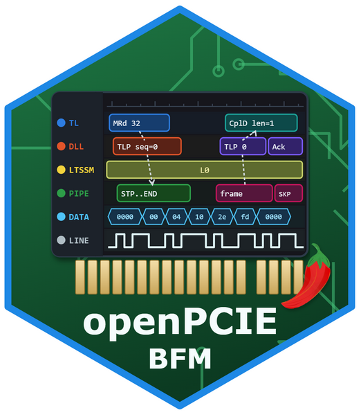
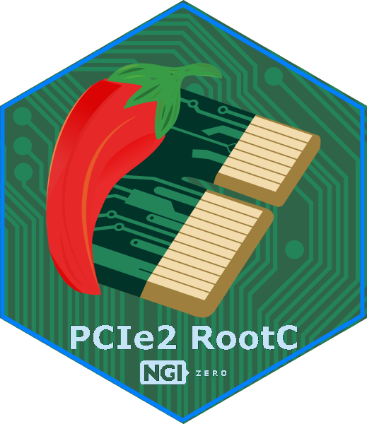
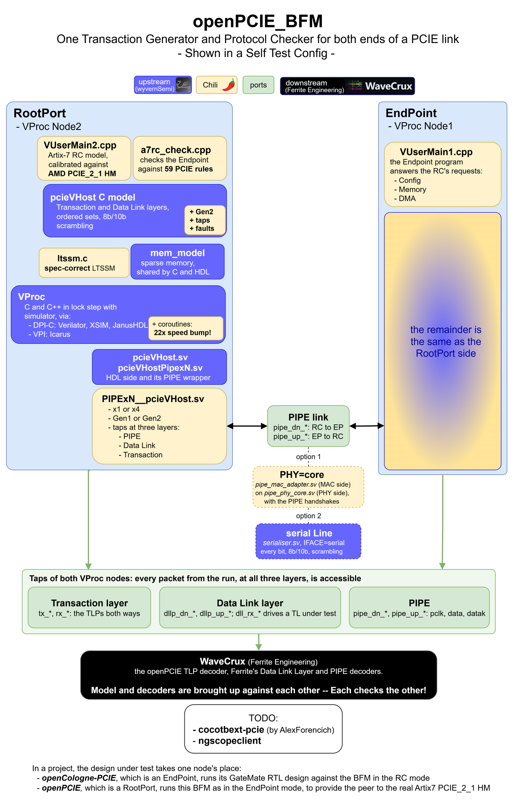
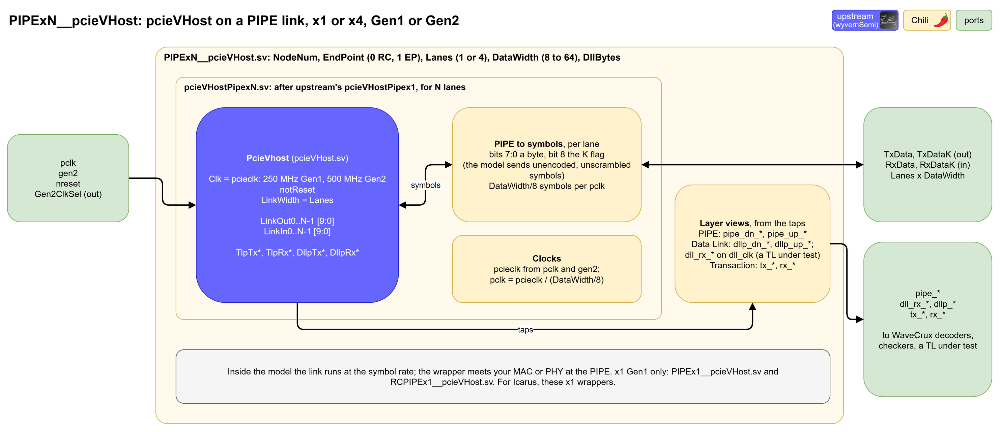
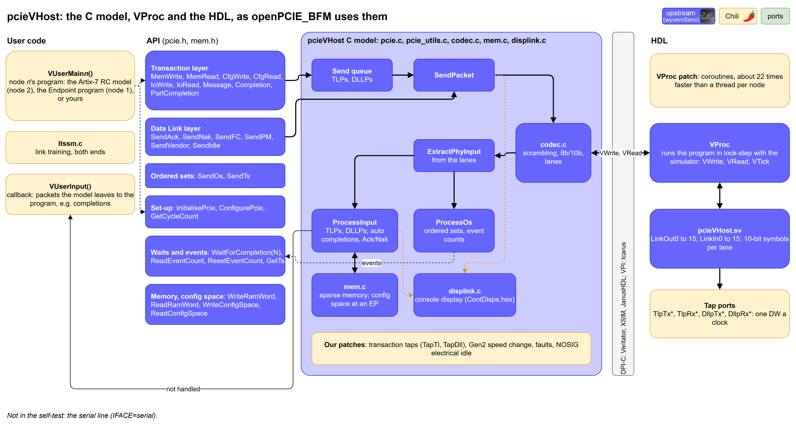
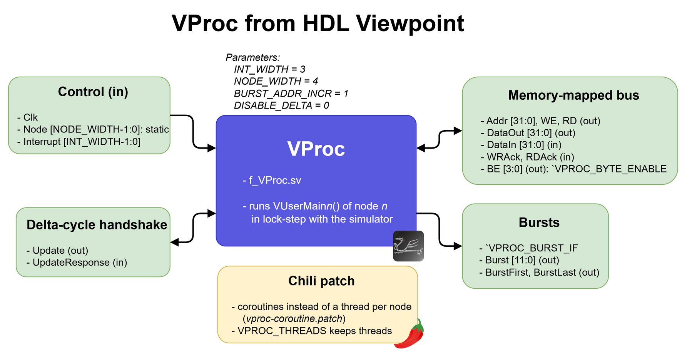
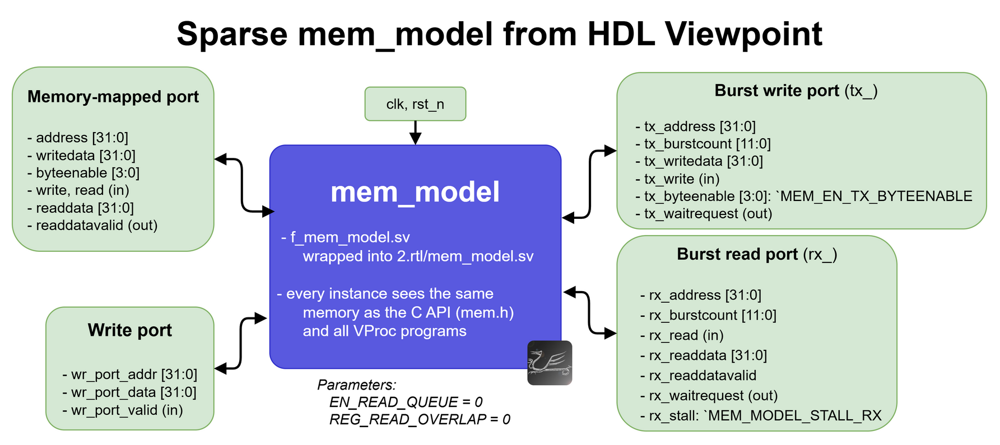
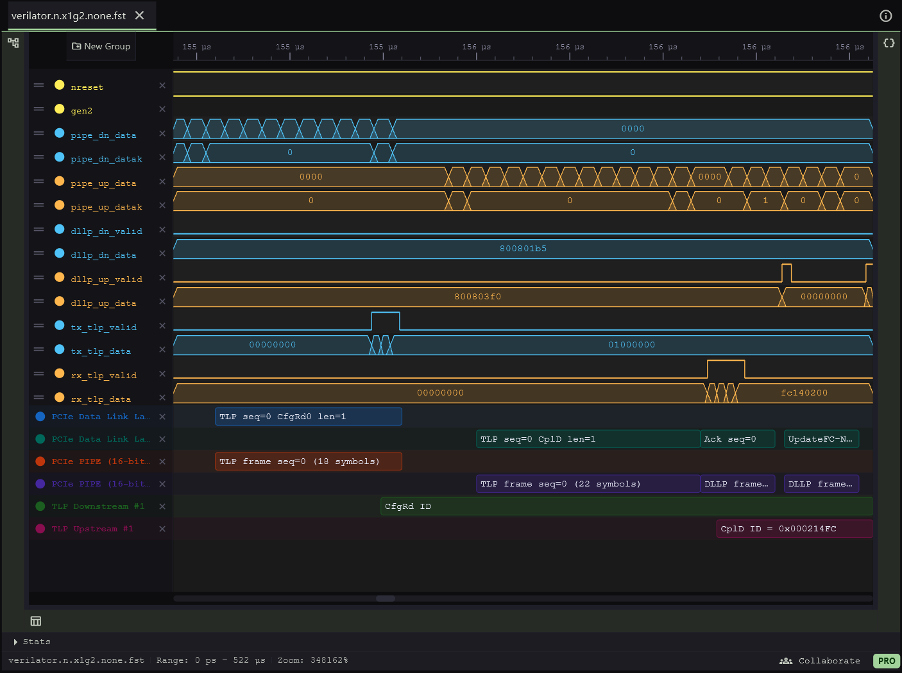

[](https://github.com/chili-chips/openPCIE_BFM/stargazers)
[](https://gitlab.com/chili-chips/openPCIE_BFM)
[](LICENSES)
[](REUSE.toml)
[](https://github.com/wyvernSemi/pcievhost)
[](https://github.com/wyvernSemi/vproc)
[](#self-test)
[](#self-test)
[](#self-test)
[](https://que.no/janushdl/)
[](https://wavecrux.app)
[](https://github.com/chipsalliance/verible)

# openPCIE_BFM

<div align="center">
  
</div>

A PCIE simulation model (bus functional model) for PIPE-based PCIE designs, built on **Simon Southwell's [pcieVHost](https://github.com/wyvernSemi/pcievhost) and [VProc](https://github.com/wyvernSemi/vproc)**. This single model plays:
- **Root Complex** or **Endpoint**
- **x1** or **x4**
- **Gen1** or **Gen2**
- **PIPE** or **Serial Line**

Above the PIPE, it also **gives access to the Data Link and Transaction layers**: taps that show every DLLP and TLP to waveform decoders and checkers, as well as a C API that sends and checks transactions.

`Cross-checked with Xilinx/AMD PCIE_2_1 HM within Artix7 FPGAs`
> Simulated side-by-side with PCIE_2_1 HM, which played the role of golden model

`Cross-checked with the [WaveCrux](https://wavecrux.app) Protocol Decoders`
> Ferrite's _PIPE_ and _Data Link Layer_ decoders and the _openPCIE TLP_ decoder read the same link in the waveform. Model and decoders were brought up against each other to check each other

To our knowledge, this makes openPCIE_BFM the first open-source PCIE transaction generator and protocol checker that is both calibrated against an industry-standard, silicon-proven PCIE hard macro and cross-checked by 3rd party protocol decoders.


### Ecosystem
This VIP is used within [openPCIE](https://github.com/chili-chips/openPCIE) (Artix-7 Root Complex) and [openCologne-PCIE](https://github.com/chili-chips/openCologne-PCIE) (GateMate Endpoint), as a git submodule of both.

<div align="center">
  <a href="https://github.com/chili-chips/openPCIE"></a>
  <a href="https://github.com/chili-chips/openCologne-PCIE"></a>
</div>

### Made for portability

| | Options |
|---|---|
| Role | Root Complex or Endpoint |
| Link | x1 or x4; Gen1 (2.5 GT/s) or Gen2 (5 GT/s) |
| Attach to | another model on the line, an RTL MAC (PHY side of PIPE) or a PIPE PHY (MAC side of PIPE): [three ways](0.doc/integration.md#three-ways-to-attach-pcievhost) |
| Simulators | Verilator, Vivado XSIM, JanusHDL (DPI-C); Icarus (VPI, x1 wrappers) |
| FPGAs | AMD Artix-7 (openPCIE), Cologne Chip GateMate (openCologne-PCIE) |

### How is it made?!

<div align="center">
  
</div>

What it adds to the upstream _pcieVHost_:

#### The Artix-7 RC model
> pcieVHost set up as the AMD `PCIE_2_1` root port, calibrated against the hard macro. It trains the link, runs the RC firmware's requests and checks the Endpoint against 59 rules of the PCIE spec.

#### Fixes and new features
> Gen2 speed change through Recovery, lane reversal and polarity, one electrical-idle rule with no X or Z, transaction taps, fault injection, co-routines in VProc (about 22 times faster), no `#` delays on register outputs (Verilator 2 to 3 times faster; [timescale and delays](0.doc/integration.md#timescale)). Details: [what we added or removed](0.doc/model-changes.md#pcievhost-what-we-added-or-removed), [the issues we fixed](0.doc/model-changes.md#simulation-issues).

#### PIPE adapters
> Our wrappers put the model on a PIPE link (x1 or x4), offer the link at the PIPE, Data Link and Transaction layers for waveform decoders, and act as the MAC or the PHY side of a PIPE with its handshakes.

### pcieVHost
A PCIE C model on a VProc virtual processor, driving the lanes of a link. Its HDL side, wrapped for a PIPE link of N lanes:

<div align="center">
  
</div>

Its C side: user code calls the API; the send and receive paths run through VProc to `pcieVHost.sv`:

<div align="center">
  
</div>

The API, configuration, display and limits: [pcieVHost summary](0.doc/pcievhost/README.md).

### Integration
How the model attaches to a design, what it exposes, how to build it: [integration notes](0.doc/integration.md).

**Transaction taps:** each node reports every TLP and DLLP it sends and receives, one per clock, under the names the WaveCrux decoders bind to:

<div align="center">
  
</div>

**VProc and mem_model:** a node's program runs on VProc; its memory is mem_model, the same for the C API and every HDL instance:

<div align="center">
  
  
</div>

### File Structure

| Path | What | License |
|---|---|---|
| `2.rtl/` | our SystemVerilog: `PIPExN__pcieVHost.sv` (x1/x4, Gen1/Gen2), `pcieVHostPipexN.sv` (our PIPE wrapper for N lanes, derived from upstream's `pcieVHostPipex1`), `PIPEx1__pcieVHost.sv` and `RCPIPEx1__pcieVHost.sv` (x1 Gen1), `pipe_mac_adapter.sv` (MAC side of PIPE), `pipe_phy_core.sv` (PHY side of PIPE), `pipe_sym_pkg.sv`, `pipe_x4_view.sv`, `mem_model.sv` | BSD-3-Clause; `pcieVHostPipexN.sv`, `mem_model.sv` GPL-3.0-or-later |
| `3.sw/a7rc/` | the Artix-7 RC model: `VUserMain2.cpp` (VProc node 2), its checker `a7rc_check.cpp`, `ep_dma.h` | BSD-3-Clause |
| `3.sw/ltssm/` | the LTSSM helper both nodes link in: `ltssm.c` (ours), `ltssm.c.orig` (upstream), `ltssm-openpcie.patch` | GPL-3.0-or-later |
| `1.upstream/patches/` | our changes to upstream: `pcievhost-taps.patch` (applied at import), `pcievhost-speed.patch`, `vproc-coroutine.patch` (applied at build) | GPL-3.0-or-later |
| `1.upstream/vip/` | upstream copies: VProc, pcieVHost, mem_model ([versions](1.upstream/vip/README.md)) | GPL-3.0-or-later |
| `4.build/` | `vip-import.sh` (upstream to `1.upstream/vip/`), `build-vip.sh` (libraries and HDL), `regress.sh` (seeds), `wavecrux.py` (a run in WaveCrux at the first violation), `wavecrux-session.py` (a WaveCrux session for a dump), `lint.verible` (the lint rules) | BSD-3-Clause |
| `5.sim-regression/` | the self-test: the RC model against the Endpoint model, back to back; sanity and regression lists | BSD-3-Clause |
| `0.doc/pcievhost/` | how to configure and drive the model | GPL-3.0-or-later |
| `0.doc/` | [the RC model and its 59 rules](0.doc/rc-model.md), [integration notes](0.doc/integration.md) (adapters, taps, VProc and mem_model, build defines), [changes to upstream](0.doc/model-changes.md) | BSD-3-Clause |

### Self-test

Two pcieVHost nodes on one PIPE link: the Artix-7 RC model (node 2) against an Endpoint model (node 1, `5.sim-regression/usercode/VUserMain1.cpp`). It passes when the RC model prints `RC MODEL RESULT: PASS`: link up, every request completed, 0 rule violations.

```sh
cd 5.sim-regression
make run                  # Verilator (default)
make SIM=icarus WRAP=x1 run   # Icarus runs the x1 wrappers only
make SIM=xsim run         # Vivado simulator
make SIM=janushdl run     # JanusHDL (jhdl)
make all-sims             # each simulator, one line each
make regress SEEDS=10     # the tester over seeds 1 to 10 (Verilator, Icarus)
make sanity               # the sanity list
make regression           # the regression list
make lint                 # Verible on our SystemVerilog (4.build/lint.verible)
make clean                # removes work/
```

`make all-sims` uses the default `WRAP=n`, which Icarus cannot run: it reports FAIL. `make all-sims WRAP=x1` runs all four on the x1 Gen1 wrappers.

Options: `LANES=1|4`, `GEN=1|2`, `PHY=none|core` (`core`: the RC model is the MAC of `pipe_mac_adapter.sv` over `pipe_phy_core.sv`), `WRAP=n|x1` (`x1`: the x1 Gen1 wrappers), `A7RC=0|1` (tester or literal), `SEED=N`. Builds, logs and runs go to `work/` (git-ignored).

- **Sanity** (`make sanity`, after every change): 7 runs, about 3 minutes. Verilator default, `LANES=4`, `PHY=core`, `A7RC=1`; Icarus `WRAP=x1`; XSIM and JanusHDL default.
- **Regression** (`make regression`, before a push): each simulator in 8 configurations (default, `WRAP=x1`, `WRAP=x1 A7RC=1`, `LANES=4`, `PHY=core`, `LANES=4 PHY=core`, `A7RC=1`, `GEN=1`), the same `===>` lines at `WRAP=x1` on all four, 10 seeds on Verilator; about 6 minutes.
- The runs that do not work yet (Icarus but `WRAP=x1`; JanusHDL `LANES=4`, `PHY=core`; table below) are listed as known: they do not fail the list, and pass it once fixed.

Results (WSL2 Ubuntu 24.04, run time without the build; `WRAP=x1` is x1 Gen1, `LANES=4` Gen1; 🟢 passes, 🟠 partly, 🔴 does not run). Within a column, every PASS prints the same `===>` lines (faults, rule counts, result):

| Simulator | default | `WRAP=x1` | `LANES=4` | `PHY=core` |
|---|---|---|---|---|
| 🟢 Verilator 5.055 | PASS, 1.9 s | PASS, 1.6 s | PASS, 2.5 s | PASS, 1.9 s |
| 🟠 Icarus 14.0 (devel) | no: `PIPExN__pcieVHost.sv` does not parse (automatic variable in an `always`, [iverilog#1789](https://github.com/steveicarus/iverilog/issues/1789)) | PASS, 4.2 s | no, as default | no, as default |
| 🟢 Vivado XSIM 2026.1 | PASS, 8.1 s | PASS, 7.8 s | PASS, 9.8 s | PASS, 10.0 s |
| 🟠 JanusHDL 0.17.0 | PASS, 32 s | PASS, 27 s | no: a cast in `pcieVHostPipexN.sv` not supported at run time | no: `pipe_mac_adapter.sv` assertions do not parse |

**Open upstream issues behind the results above:**

| Tool | Issue | What | State |
|---|---|---|---|
| Icarus Verilog | [iverilog#1789](https://github.com/steveicarus/iverilog/issues/1789), ours [#2](https://github.com/chili-chips/openPCIE_BFM/issues/2) | an `automatic` variable in a static `always` block (`PIPExN__pcieVHost.sv:120`) | open |
| JanusHDL | [#1](https://github.com/chili-chips/openPCIE_BFM/issues/1) | a size cast by a parameter, `W'(x)`, at run time (`LANES=4`) | open |
| JanusHDL | [openCologne-PCIE#1](https://github.com/chili-chips/openCologne-PCIE/issues/1) | no assertions yet; a labelled one gives a parse error (`PHY=core`) | open |
| JanusHDL | [#3](https://github.com/chili-chips/openPCIE_BFM/issues/3) | no command-line default timescale; `+timescale+` ignored: always 1ns/1ps | open |

JanusHDL has no public tracker (closed source, so it can read encrypted IP): its issues are in our repos, under the [`JanusHDL` label](https://github.com/issues?q=org%3Achili-chips+label%3AJanusHDL).

Needs gcc/g++, make, patch, and the simulator. Icarus needs its `vpi_user.h`; XSIM finds Vivado via `XILINX_VIVADO`.

### Waveforms

`make WAVES=1 run` (any option, any simulator) also writes `work/waves/<SIM>.<config>.fst` and a [WaveCrux](https://wavecrux.app) session for it, `work/waves/<SIM>.<config>.wavecrux`: open the session (File > Open). It shows the link both ways, RC -> EP blue, EP -> RC orange: lane 0 at the PIPE (all four at `LANES=4`), the DLLPs and the TLPs, with Ferrite's PIPE and Data Link Layer decoders and the openPCIE TLP decoder. The LTSSM runs in C (`3.sw/ltssm`): the PIPE decoder shows its ordered sets.

<div align="center">
  
</div>

The first configuration read of a run, at 155.5 µs: `CfgRd0` down, `CplD` up 48 ns later, then the Endpoint's `Ack` and `UpdateFC`, decoded at all three layers.

A session binds by signal number, which differs between simulators, so each FST gets its own (`4.build/wavecrux-session.py`). The two next to the Makefile are for Verilator's default and `LANES=4` dumps: `tb.x1g2.TLP-DLL-PIPE.wavecrux`, `tb.x4g1.TLP-DLL-PIPE.wavecrux`. Needs `fst2vcd` (GTKWave), and `vcd2fst` for XSIM and JanusHDL, which write VCD.

### How to use it in your project

Add it as a submodule, e.g. at `5.sim/openPCIE_BFM`:

```sh
git submodule add https://github.com/chili-chips/openPCIE_BFM.git 5.sim/openPCIE_BFM
```

Then, as `5.sim-regression/Makefile` does:

1. Build the VIP once: `VIP_DIR=$(VIP_PATCH=<bfm>/1.upstream/patches/pcievhost-speed.patch VPROC_PATCH=<bfm>/1.upstream/patches/vproc-coroutine.patch bash <bfm>/4.build/build-vip.sh)`. It prints the directory with `lib/` (DPI-C: `libcosimlnx.a`, `libpcielnx.a`; VPI: `libcosimica.a`, `libpcieica.a`), `include/` and `hdl/`.
2. Compile your node programs with `3.sw/ltssm/ltssm.c` and, for the RC model, `3.sw/a7rc/VUserMain2.cpp` and `3.sw/a7rc/a7rc_check.cpp`. Defines: `-DVPROC -DEXCLUDE_LTSSM`, plus `-DVPROC_SV` (Verilator, XSIM, JanusHDL) or `-DICARUS`.
3. Compile the HDL from `$VIP_DIR/hdl` and `2.rtl/`, with `+define+VPROC_BYTE_ENABLE` (and `VPROC_SV` but on Icarus). The top module must be `tb` with a task `Fatal`: pcieVHost calls `tb.Fatal`. No `` `timescale `` in the HDL: pass one on the command line ([per simulator](0.doc/integration.md#timescale)).
4. Your project keeps its own: test benches, socket wrappers around these models, Endpoint programs, waveform views of the DUT.

An Endpoint other than ours tells the RC model what to expect with `-DA7RC_EP_EXPECT='"file.h"'` (IDs and BAR sizes; see `3.sw/a7rc/VUserMain2.cpp`).

#### License

Two licenses, side by side, per file (`REUSE.toml`, `LICENSES/`; `reuse lint` passes):

- **GPL-3.0-or-later:** pcieVHost, VProc and mem_model (`1.upstream/vip/`), our changes to them (`1.upstream/patches/`, `3.sw/ltssm/`), `2.rtl/pcieVHostPipexN.sv`, `2.rtl/mem_model.sv`, `0.doc/pcievhost/`.
- **BSD-3-Clause:** everything else: the wrappers and adapters in `2.rtl/`, the RC model (`3.sw/a7rc/`), tools, self-test.

#### Credits and Acknowledgments

**This model stands on Simon Southwell's work.** pcieVHost (the PCIE link model: LTSSM, Data Link and Transaction layers, the C API), VProc (the virtual processor that runs C programs against HDL) and mem_model (the sparse memory model) are his, GPL-3.0-or-later. This repository carries copies of them with our changes; upstream stays the reference for the model and its manual. His help on _openPCIE_ and _openCologne-PCIE_ made a world of difference. Thank you, Simon!

<div align="center">
  <a href="https://github.com/wyvernSemi"></a>
</div>

**WaveCrux, by Ferrite Engineering, is our second pair of eyes.** Its PIPE and Data Link Layer protocol decoders read every link this model drives, independently of it; model and decoders were brought up against each other, so each one checks the other. They fixed the decoder timing in WaveCrux 1.0.1 on our report, wrote the PIPE, Data Link Layer and serial-line decoders for openPCIE and openCologne-PCIE, and host our TLP decoder in [wavecrux-decoders](https://github.com/Ferrite-Engineering/wavecrux-decoders). Thank you, Ferrite!

<div align="center">
  <a href="https://wavecrux.app"></a>
</div>

The PIPE adapters and the Artix-7 RC model are by Chili.CHIPS; this repository is volunteer work. They were proven in the test and validation jigs of our two PCIE projects, both sponsored by [NLnet](https://nlnet.nl):

- [openPCIE](https://github.com/chili-chips/openPCIE): the RC model against the AMD `PCIE_2_1` hard macro, at x1 and x4, Gen1 and Gen2.
- [openCologne-PCIE](https://github.com/chili-chips/openCologne-PCIE): the RC model against an open-source GateMate Endpoint, at the PIPE and on the serial line.

The RC model is calibrated against the AMD (Xilinx) 7 Series `PCIE_2_1` hard macro and its user guide, [UG477](https://docs.xilinx.com/v/u/en-US/ug477_7Series_IntBlock_PCIe): its link training, timing and request behaviour were measured on the hard macro and modelled after it.

#### References

- [pcieVHost](https://github.com/wyvernSemi/pcievhost), Simon Southwell: the PCIE model, and its [manual](https://github.com/wyvernSemi/pcievhost/blob/master/doc/pcieVHost.pdf)
- [VProc](https://github.com/wyvernSemi/vproc), Simon Southwell: the virtual processor co-simulation element
- [mem_model](https://github.com/wyvernSemi/mem_model), Simon Southwell: the sparse memory model
- [PCI Express Primer](http://www.anita-simulators.org.uk/wyvernsemi/articles/pci_express.pdf), Simon Southwell
- [openPCIE](https://github.com/chili-chips/openPCIE) and [openCologne-PCIE](https://github.com/chili-chips/openCologne-PCIE): the projects this model came from
- [WaveCrux](https://wavecrux.app) and [wavecrux-decoders](https://github.com/Ferrite-Engineering/wavecrux-decoders), Ferrite Engineering: the waveform viewer and the PCIE protocol decoders we cross-check with
- AMD (Xilinx) [UG477](https://docs.xilinx.com/v/u/en-US/ug477_7Series_IntBlock_PCIe): 7 Series FPGAs Integrated Block for PCI Express, the `PCIE_2_1` hard macro the RC model is calibrated against
- [cocotbext-pcie](https://github.com/alexforencich/cocotbext-pcie), Alex Forencich: a PCIE transaction-level model for cocotb (Python), related work
- [ngscopeclient](https://www.ngscopeclient.org): open-source signal analysis for oscilloscopes and logic analyzers, with protocol decoders

---
---
# Community Outreach

**Issues filed upstream** from this project, open and closed. Details of the open ones: [Self-test](#self-test). The model's earlier issues, from the openPCIE work it came from: [openPCIE](https://github.com/chili-chips/openPCIE#community-outreach).

| Tool / project | Issue | What | State |
|---|---|---|---|
| Icarus Verilog | [iverilog#1789](https://github.com/steveicarus/iverilog/issues/1789), ours [#2](https://github.com/chili-chips/openPCIE_BFM/issues/2) | an `automatic` variable in a static `always` block (`PIPExN__pcieVHost.sv:120`) | open |
| Verilator | [verilator#9240](https://github.com/verilator/verilator/issues/9240), ours [#4](https://github.com/chili-chips/openPCIE_BFM/issues/4) | a time literal finer than the time precision is not rounded (`1ps` at 1ns/10ps); our clocks no longer depend on it | open |
| JanusHDL | [#1](https://github.com/chili-chips/openPCIE_BFM/issues/1) | 0.17.0: a size cast by a parameter, `W'(x)`, at run time (`LANES=4`) | open |
| JanusHDL | [openCologne-PCIE#1](https://github.com/chili-chips/openCologne-PCIE/issues/1) | 0.17.0: no assertions yet; a labelled one gives a parse error (`PHY=core`) | open |
| JanusHDL | [#3](https://github.com/chili-chips/openPCIE_BFM/issues/3) | 0.17.0: no command-line default timescale; `+timescale+` ignored: always 1ns/1ps | open |

JanusHDL has no public tracker (closed source, so it can read encrypted IP): its issues are in our repos, under the [`JanusHDL` label](https://github.com/issues?q=org%3Achili-chips+label%3AJanusHDL).

---
---
# Opensource Tooling

The model is **`purposely designed to run on open-source and/or free simulators`**. The project is grateful to their developers, maintainers and wider community that keeps using and improving them. One of our objectives is also to provide first-hand feedback on these verification staples, as well as a robust test and regression jig for them. Towards that goal, we also validate with Vivado XSIM, which serves as baseline / reference point.

<div align="center">
  <a href="https://www.veripool.org/verilator"></a>
  <a href="https://github.com/steveicarus/iverilog"></a>
  <a href="https://que.no/janushdl"></a>
</div>

<div align="center">
  <a href="https://github.com/chipsalliance/verible"></a>
</div>

- **Simulators and Linters**: [Verilator](https://www.veripool.org/verilator), [Icarus Verilog](https://github.com/steveicarus/iverilog), [JanusHDL](https://que.no/janushdl/), Vivado XSIM
- **Waveforms, Protocol Decoders, Checkers**: [WaveCrux](https://wavecrux.app)
- **Neat Formatting, Lint**: [Verible](https://github.com/chipsalliance/verible), `make lint` in `5.sim-regression`

---
## GenAI

Our repo may contain elements of work facilitated by modern GenAI tools , used under the guidance and supervision of the blood-and-flesh developers.

In the end, it is us, the human devs, who are fully responsible for any shortfalls you may uncover while tapping into repo resources.

--------------------
#### End of Document
